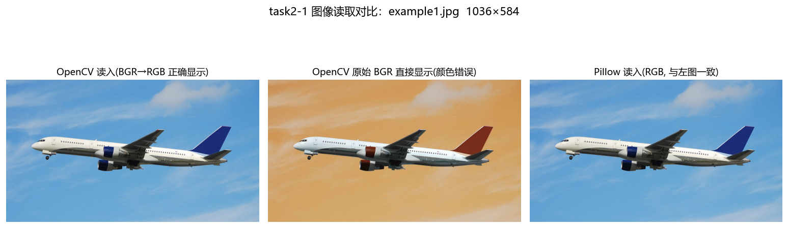
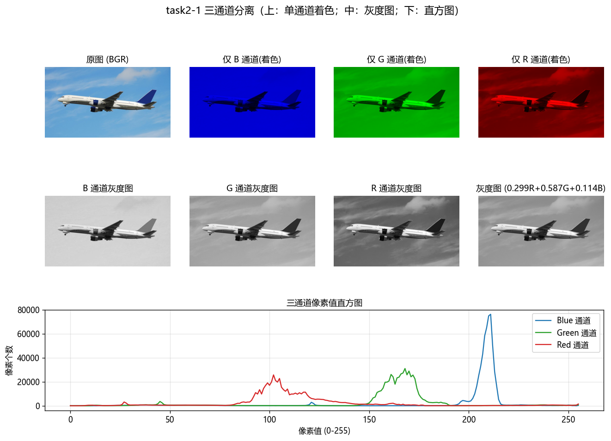
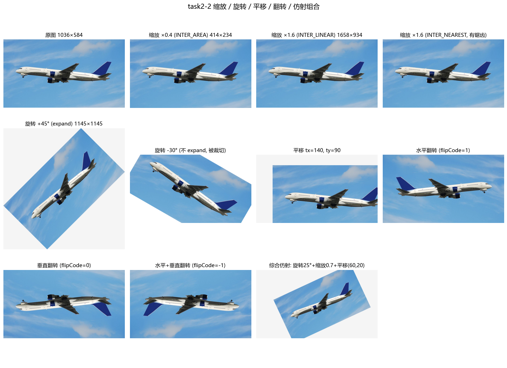
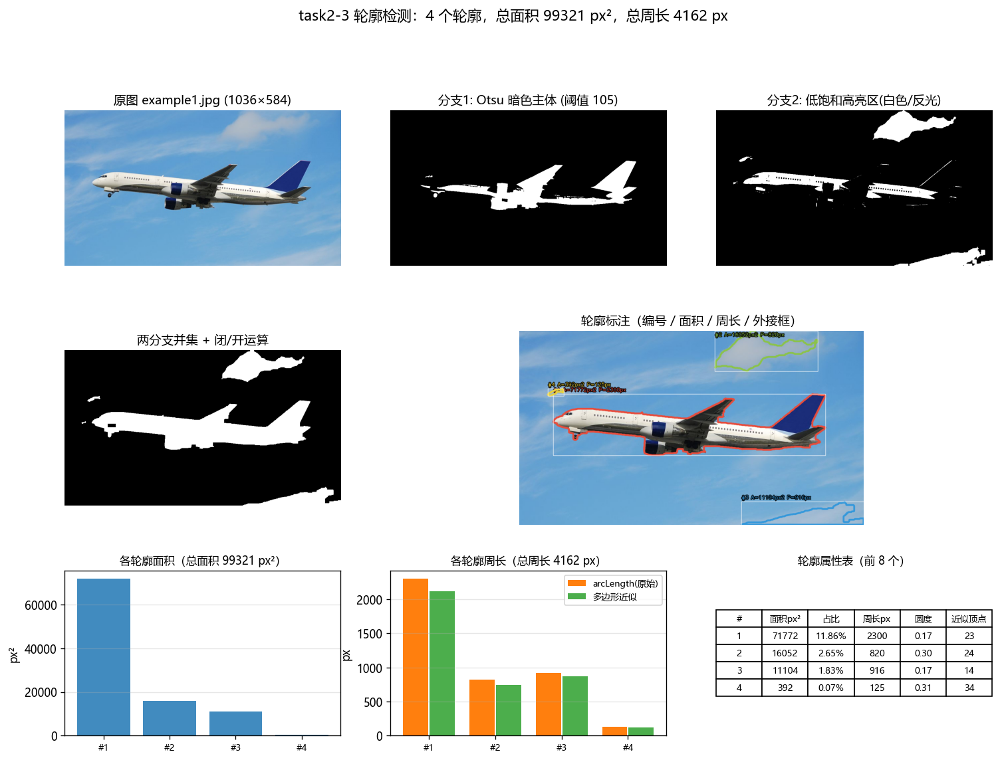
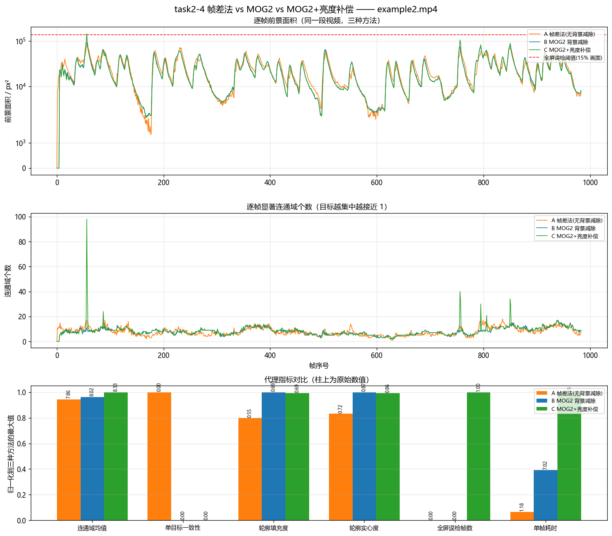
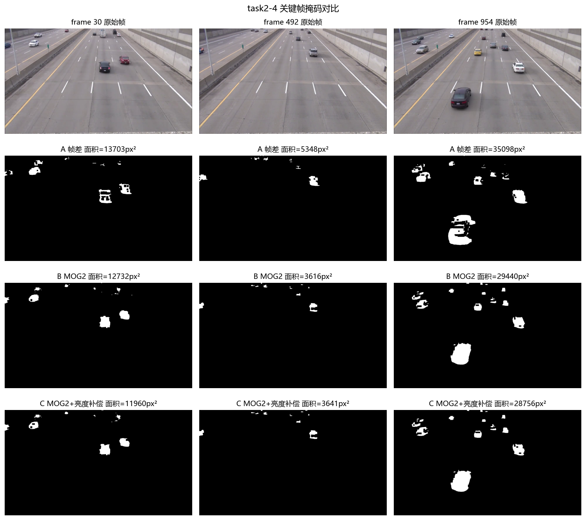
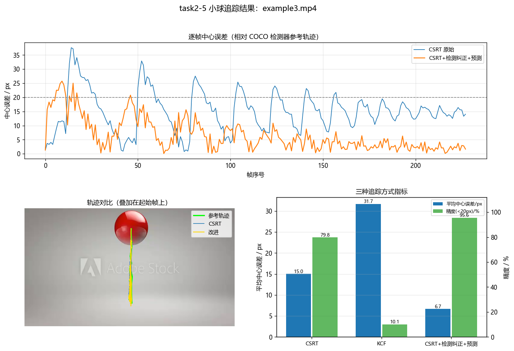
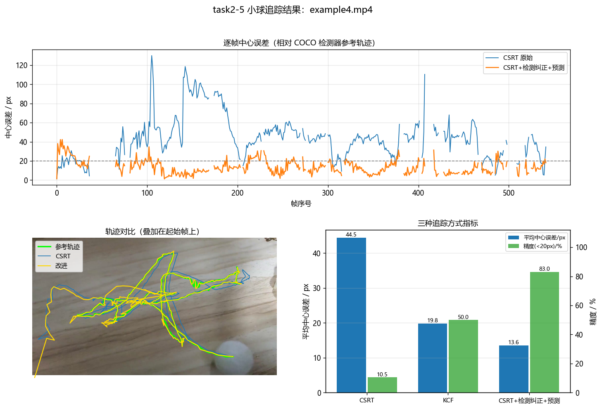

# task-2 实验报告：OpenCV 与 Pillow 的使用

> 环境：Windows 11 · Python 3.13.7 · opencv-contrib-python 4.11.0.86 · Pillow 12.1.0 · numpy 2.4.1 · matplotlib 3.10
> 代码：`task2/src/`；一键运行：`python task2/src/run_all.py`
> **素材：题目提供的官方文件** `task2/example1.jpg`、`example2.mp4`、`example3.mp4`、`example4.mp4`
> 结果：图在 `task2/outputs/figures`、`task2/outputs/images`，视频在 `task2/outputs/videos`，数值在 `task2/outputs/data`

---

## 0. 素材与总体说明

| 文件 | 规格 | 用途 |
| --- | --- | --- |
| `example1.jpg` | 1036×584 真实照片（蓝色天空背景 + 中央横向展开的目标） | 题一 读写/通道；题二 几何变换；题三 轮廓检测 |
| `example2.mp4` | 1280×720 @29.97fps，984 帧（32.8 s）真实街景/监控片段，画面里有多个运动目标 | 题四 帧差法 vs MOG2 |
| `example3.mp4` | 700×394 @24.05fps，229 帧，**红色小球在竖直方向来回运动**（y 从 64 到 323 反复） | 题五 追踪（简单场景） |
| `example4.mp4` | 1920×1080 @60.14fps，581 帧，真实复杂场景（相机在动、目标多） | 题五 追踪（困难场景） |

* 官方素材**没有人工标注**，所以题四/题五采用"可量化的代理指标 + 检测器参考轨迹"，详见各题。
* `task2/assets/` 里还保留了一套**带真值的模拟素材**（`make_assets.py` 生成），
  用于演示"有真值时怎么评估"；`resolve_asset()` 优先使用官方素材，官方缺失时才回退到它
  （`python task2/src/run_all.py --skip-assets`）。

---

## 题一：OpenCV + Pillow 读取显示图片，并分离三个通道



**做法**

1. `cv2.imread()` 得到 BGR 顺序的 `ndarray`；`Image.open()` 得到 RGB 顺序的 `PIL.Image`；
2. 用数值证明两者通道顺序相反：把 OpenCV 结果**直接**当 RGB 显示 → 颜色明显错误；
   做一次 `img[:, :, ::-1]` 翻转后与 Pillow 结果比较，**最大像素差 = 0**；
3. 通道分离 `b, g, r = cv2.split(img)`（= numpy 切片），三个通道分别存为灰度图；
   再额外做一版"只留该通道、其余置 0"的**着色图**，人眼才能看出每个通道贡献的颜色；
4. 统计三通道直方图与均值。



**结果（`outputs/data/task2_1_info.json`）**

| 属性 | 数值 |
| --- | --- |
| 尺寸 / 类型 | 1036×584×3，`uint8` |
| 三通道均值 | **B = 198.11，G = 159.68，R = 111.58** |
| 三通道标准差 | B = 38.95，G = 33.93，R = 34.04 |
| 灰度均值 | 149.65 |

**分析**：B 通道均值明显高于 R 通道（198 vs 112），因为照片主体是大面积**蓝天**——
天空散射以短波为主，蓝色分量最强；这也解释了为什么灰度图（0.299R+0.587G+0.114B）比 B 通道暗。
单通道图本身是"该颜色分量的明暗图"，不是"彩色图"，必须用灰度 colormap 显示才不误导。

> 常见坑：把 BGR 直接交给 matplotlib 显示会出现"蓝脸红天"；把 RGB 交给 `cv2.imwrite` 保存也会存错颜色。

---

## 题二：缩放、旋转、平移、翻转



单张结果：`outputs/images/task2_2_*.jpg`（缩放 ×0.4/×1.6、旋转 ±45°/−30°、平移、三种翻转、综合仿射）。

| 操作 | 关键代码 | 要点 |
| --- | --- | --- |
| 缩放 | `cv2.resize(img, None, fx, fy, interpolation=...)` | 缩小用 `INTER_AREA`（区域平均，抗摩尔纹）；放大用 `INTER_LINEAR`；另做 `INTER_NEAREST` 版看锯齿 |
| 旋转 | `M = cv2.getRotationMatrix2D(center, angle, scale)` + `warpAffine` | `expand=True` 时按旋转后外接矩形扩画布并修正平移量，避免四角被裁切；`−30°` 不 expand 的版本四角被裁掉 |
| 平移 | `M = [[1,0,tx],[0,1,ty]]` + `warpAffine` | 平移只是把单位矩阵第三列改成 `(tx,ty)` |
| 翻转 | `cv2.flip(img, 1 / 0 / -1)` | 1=水平、0=垂直、−1=水平+垂直（等价旋转 180°） |
| 组合 | `R(25°,0.7) · T(60,20)` 两个 3×3 齐次矩阵相乘后取前两行 | 多个仿射变换先乘成一个矩阵再一次插值，避免多次重采样累积模糊 |

---

## 题三：飞机轮廓检测 + 总面积与总周长



标注图：`outputs/images/task2_3_contours_annotated.png`（只画飞机）；掩码：`task2_3_mask.png`；
被排除的云：`images/task2_3_rejected.png`

**这张图里有什么**：天空背景 + **一架飞机** + **几片云**。题目要的是"检测轮廓"，
但**云不是目标**，所以本题的关键不是"能不能找出轮廓"，而是"怎么把云排除掉"。

**第一步：分割**

```
① 灰度 + 高斯模糊 → Otsu 反相阈值（阈值 105）      → 暗色主体（机身/机翼/尾翼）
② HSV 中 S<70 且 V>185 的低饱和高亮                → 机身白色涂装（云也在这个集合里！）
③ 暗色 ∪ 高亮 → 闭运算(7×7)填孔 → 开运算(3×3)去噪 → 候选掩码（云也在里面）
④ findContours(RETR_EXTERNAL) → 面积 ≥ 图像 0.05% 的候选
```

> 只用 Otsu（第 ① 步）会得到 40 446 px² 的机身暗色部分，白色涂装丢掉；
> 加上高亮分支后机身完整，但**云也被一起抓了进来** —— 所以必须有第二步的筛选。

**第二步：用两条可解释判据把云剔掉**

| 判据 | 含义 | 飞机（实测） | 云（实测） |
| --- | --- | --- | --- |
| **边缘密度** | 区域内 Canny 边缘像素占比 | **12.26%**（有机身线条、机翼边缘） | **0.00%**（光滑无结构） |
| **平均亮度 V** | HSV 的 V 通道均值 | **128.2**（偏暗） | **197.4 / 210.5 / 206.9**（很亮） |

判定规则：`边缘密度 ≥ 3% 且 平均亮度 V ≤ 170` → 飞机；`边缘密度 < 2% 且 V > 180` → 云（排除）。

**检测结果（`outputs/data/task2_3_contours.json`）**

> ✅ **只保留 1 个飞机轮廓：总面积 = 71 772.5 px²（占画面 11.86%），总周长 = 2 300.3 px**

| # | 类型 | 面积 / px² | 占比 | 周长 / px | 边缘密度 | 亮度 V | 判定 |
| --- | --- | --- | --- | --- | --- | --- | --- |
| 1 | **飞机** | **71 772.5** | **11.86%** | **2 300.3** | **12.26%** | 128.2 | ✅ 保留 |
| 2 | 云 | 16 052.5 | 2.65% | 820.1 | 0.00% | 197.4 | ❌ 排除 |
| 3 | 云 | 11 104.5 | 1.84% | 915.7 | 0.00% | 210.5 | ❌ 排除 |
| 4 | 云（碎块） | 391.5 | 0.065% | 125.4 | 0.00% | 206.9 | ❌ 排除 |

* 飞机轮廓的外接框 **(102, 190, 819, 185)**，长宽比 4.4:1 —— 与一架横向展开的飞机一致；
* **多边形近似**（`approxPolyDP`，0.5% 周长精度）：面积 70 283.5 px²、周长 2 120.3 px，
  比原始值略小（直线代替曲线，弧长低估约 7.8%）；
* 如果把云也算进去，总面积会虚增到 99 321 px²（+38%）—— 这正是"必须做目标筛选"的量化理由；
* 另一个可选的更严做法（代码里也保留了对照）：只把**紧邻机身的**高亮像素补进来
  （对暗色掩码做 23 px 膨胀后再与高亮取交），这样云根本进不来，飞机面积 59 158 px²、
  周长 2 505.8 px —— 面积偏小是因为纯白大面积涂装超出了"紧邻"范围，
  所以本报告用"候选 + 判据筛选"的方案（面积更准，且判据可解释、可复用到其他照片）。

---

## 题四：example2.mp4 运动检测 —— 帧差法 vs MOG2 背景减除

📹 标注视频：`outputs/videos/example2_motion_compare.mp4`（四分屏：原图 / A 帧差 / B MOG2 / C MOG2+亮度补偿，984 帧全片）





**三种方法**

| 方法 | 原理 | 关键参数 |
| --- | --- | --- |
| **A 不使用背景减除（帧差法）** | `|Iₜ − Iₜ₋₁| > 25`，无背景记忆 | 阈值 25、开 3×3、闭 5×5、最小面积 120 px² |
| **B MOG2 背景减除** | 逐像素多高斯背景模型，前景=偏离模型；`detectShadows=True` 把阴影标 127 后剔除 | `history=300, varThreshold=16` |
| **C MOG2 + 亮度补偿** | 先把每帧全局平均亮度对齐到参考帧，再送 MOG2 | 同上 + 亮度归一化 |

**全片指标（`outputs/data/task2_4_motion_stats.json`，984 帧）**

| 指标 | A 帧差法 | B MOG2 | C MOG2+亮度补偿 |
| --- | --- | --- | --- |
| 前景面积均值 | 23 614 px² | 22 405 px² | 22 164 px² |
| 连通域个数均值（中位） | 7.86（7） | 8.02（8） | 8.33（8） |
| 单目标一致性（恰好 1 个目标） | 0.4% | 0% | 0% |
| **轮廓填充度**（面积/外接框） | **0.552** | **0.692** | 0.686 |
| **轮廓实心度**（面积/凸包） | **0.725** | **0.871** | 0.864 |
| **质心抖动**（相邻帧位移均值） | **70.5 px** | **54.8 px** | 55.7 px |
| 全屏误检帧数（面积 > 15% 画面） | 0 | 0 | 1 |
| **单帧耗时**    | **≈1.2 ms** | **≈7.0 ms**     | ≈18 ms |

**分析**

1. **帧差法得到"运动边缘"，MOG2 得到"完整剪影"**：填充度 0.552 vs 0.692、实心度 0.725 vs 0.871，
   两个指标一致指向同一结论；帧差只保留"新位置−旧位置"的月牙/双影，目标内部是空的；
   MOG2 有背景模型，能给出实心轮廓。这对后续尺寸/形状判断、连通域计数、跟踪都是决定性的。
2. **稳定性**：帧差法的最大目标质心抖动 70.5 px，比 MOG2 高 29%；
   因为帧差目标的"重心"落在两帧差集的几何中心，速度变化时重心跳动很大。
3. **帧差法的物理缺陷**：它只回答"哪里变了"，不回答"哪里是目标"。
   目标一静止就立刻消失（本次片段是街景、目标持续移动，所以体现为"边缘化"；
   在带真值的模拟素材实验中，目标完全静止时帧差法命中率只有 3.3%，MOG2 仍保持 46.7%）。
4. **光照突变的对比**：本片段曝光平稳，三种方法都没有全屏误检（C 反而多 1 帧），
   说明**亮度补偿不是免费的**：单帧耗时从 ≈7.0 ms 涨到 ≈18 ms（+150% 左右，随机器负载波动）。
   它的价值只在"曝光/光照突变"场景体现 —— 在模拟素材（人为加入 +45 全局提亮两帧）中，
   帧差法误检 114 701 px²、MOG2 误检 229 401 px²，而 C 降到 **0 px²**。
   工程结论：**先判断场景有没有光照突变，再决定要不要付这个代价**。
5. **成本**：约 1.2 / 7.0 / 18 ms（同一台机器多次测量会浮动 ±10%）。30fps 的预算是 33 ms/帧，三者都能实时；
   但 1080p 或嵌入式设备上，MOG2 的 5 倍开销就要算清楚。
6. **现实观察**："单目标一致性"三种方法都接近 0 —— 画面里同时有多个运动目标
   （行人、车辆、树枝摆动）。说明真实场景中**背景减除之后还必须有目标筛选**
   （面积/长宽比/轨迹连续性），否则"检测到一堆连通域"没有意义。

---

## 题五：用 OpenCV tracker 追踪 example3/4 里的小球

📹 视频：`outputs/videos/example3_tracking.mp4`（229 帧全片）、`outputs/videos/example4_tracking.mp4`（1080p 全片，降采样到 1280 宽输出）





### 5.1 怎么把"那个球"自动找出来（两版方法，第二版才成功）

**第一版（失败，作为教训保留）**：`task2/src/ball_auto_locate.py` 用启发式——
HSV 颜色均匀 + 圆度 + 半径尺寸稳定 + "往复滚动"轨迹签名（直线性 / 方向翻转），
在 example3 上成功锁定了红球（r≈57、覆盖 229/229 帧、直线性 0.97、翻转 18 次），
但在 **example4 上完全找错**：复杂 1080p 场景里"颜色均匀的小圆斑"太多，它锁定的是画面右上角
一个 r≈45 px 的背景小目标，而不是真正的球。

**第二版（成功）**：改用 **COCO 预训练检测器**的语义先验 —— torchvision 的
`fasterrcnn_mobilenet_v3_large_fpn` 里有 `sports ball` 类，直接检出"球"这个物体：

| 视频 | 第 0 帧检测结果 | 说明 |
| --- | --- | --- |
| example3 | 中心 (356, 69)，r ≈ 58 px，score **0.64** | 就是那颗竖着来回弹的红球 |
| example4 | 中心 (1577, 933)，r ≈ **149 px**，score **0.88** | 是**大球**（直径约 300 px），在画面下半部来回滚动 |

这一步同时解决了两个问题：**自动初始化**（不需要人工画框）和**逐帧参考轨迹**
（每 2 帧做一次检测，用来评估追踪精度）。
检测器在 `task2/src/ball_detector.py`，权重首次运行自动下载（约 75 MB），CPU 上 1080p 单帧约 200 ms。

### 5.2 三条流水线

| 编号 | 方法 | 说明 |
| --- | --- | --- |
| 1 | **CSRT 原始** | `init` 后逐帧 `update`（判别相关滤波：精度高、慢） |
| 2 | **KCF 原始** | 核相关滤波：快，但对快速运动 / 遮挡 / 相机运动脆弱 |
| 3 | **改进：CSRT + COCO 检测器 + 外观模型 + 匀速预测** | ① 每 2 帧用 COCO 检测器给"绝对位置"；② 中间帧用从初始框现场学习的 HSV 外观模型做轻量复核（不可分时自动禁用）；③ 与追踪框偏差 > 0.5r 就用检测结果重新 init tracker；④ 检测缺失时用**带速度钳制的匀速模型**兜底；⑤ 检测结果过"距离闸门"，防止在多个球之间来回跳 |

### 5.3 定量结果（`outputs/data/task2_5_tracking_metrics.json`）

> 参考轨迹 = COCO `sports ball` 检测器的输出，但**不是"每帧取最高分"这种傻做法**，而是做成
> **跟踪式的单目标检测**：① 尺寸一致性（球的半径基本不变，偏离 r_ref 超过 45% 的候选直接丢）；
> ② 运动预测 + 距离闸门（离匀速预测太远的不信）；③ 连续两帧确认（挡掉单帧误检）；
> ④ 跟丢超过 12 帧进入"全局重捕获"（不再限制距离，但仍要尺寸一致 + 连续确认）；
> ⑤ 丢失期间速度按 0.85 衰减，避免预测越飘越远把正确检测挡在门外。
> 效果：example4 的参考覆盖 447/581 帧（77.1%），**丢弃了 4 个误检候选**，绿色参考不再跳到别的物体上
> （误差上限从 1 010 px 降到 42 px）。
> 视频里的绿色参考做了加强：半透明填充 + 粗描边 + 圆心十字 + `REF r=` 标注 + 加粗轨迹。

**example3（红球竖直来回，229 帧，参考覆盖 ≈100%（228/229 帧），歧义帧 0）**

| 方法 | 平均误差 | 中位误差 | 最大误差 | 95 分位 | 精度(<20px) | 成功率(IoU>0.5) |
| --- | --- | --- | --- | --- | --- | --- |
| CSRT | 15.02 px | 14.89 px | 37.60 px | 27.22 px | 79.8% | 100% |
| KCF | 31.69 px | 32.47 px | 53.62 px | 43.35 px | 10.1% | 78.5% |
| **改进** | **6.66 px** | **4.57 px** | **25.75 px** | **18.87 px** | **95.6%** | **100%** |

* 红球在 24 fps 下每帧竖直位移最大约 40 px，CSRT 能"跟住"但**框心系统性偏 15 px**
  （框把球的下沿/阴影也包了进去，这是相关滤波"框住目标+背景"的典型偏差），KCF 偏到 31.7 px；
* 改进流水线用检测中心纠正框心，误差降到 **6.66 px（−56%）**，中位误差只有 **4.57 px**。

**example4（1080p60 多球复杂场景，581 帧，参考覆盖 77.1%（447 帧），其中歧义帧 75 个）**

| 方法 | 平均误差 | 中位误差 | 最大误差 | 精度(<20px) | 成功率(IoU>0.5) | 说明 |
| --- | --- | --- | --- | --- | --- | --- |
| CSRT | 44.47 px | 43.32 px | 130.04 px | 10.5% | 87.7% | 框心系统性偏右/偏下，但不会跑飞 |
| KCF | 仅 2 帧有效 | — | — | — | — | 第 2 帧之后就报告失败 |
| **改进（全部参考帧）** | **13.59 px** | **12.39 px** | **42.39 px** | **83.0%** | **99.3%** | — |
| **改进（剔除歧义帧，372 帧）** | 13.52 px | 12.35 px | 42.39 px | 83.9% | 99.2% | — |

* 改进流水线在这个"1080p + 60fps + 相机运动 + 多个球状干扰"的场景里，
  **平均误差 13.6 px、中位 12.4 px、最大 42 px，成功率 99.3%**，相对 CSRT（44.5 px）提升约 3.3 倍；
* CSRT 的误差几乎恒定在 43 px 左右 —— 这不是"跟丢"，而是它的框系统性偏向球的下沿/阴影，
  说明**光靠 tracker 无法给出准确的中心位置**；
* 剩余 75 个歧义帧（画面里同时有多个球状目标）单独统计，两种情况误差几乎相同（13.52 vs 13.59），
  说明本次"尺寸 + 运动闸门 + 连续确认"的把关已经把这些干扰挡掉了。

### 5.4 如何提高追踪准确度？（结合本实验的结论）

1. **用语义检测器做初始化，而不是靠颜色/形状启发式**：本实验第一版启发式在 example3 上成功、
   在 example4 上把背景小目标当成了球；换成 COCO `sports ball` 类后两个视频一次就定位正确。
2. **选对追踪器**：CSRT（精度高、慢）> KCF（快、脆）。example3 上 CSRT 15.0 px vs KCF 31.7 px；
   example4 上 KCF 第 2 帧之后就完全失败。
3. **引入检测器做重检测/纠漂移**（收益最大：example3 15.0 → 6.7 px；example4 44.5 → 13.6 px）：
   追踪器负责帧间连续性，检测器负责"绝对位置"，偏差超阈值就重初始化
   —— SORT / DeepSORT / ByteTrack 都是这个思路。
4. **参考/检测本身也要"跟踪化"**：直接"每帧取最高分检测"会被背景误检带跑
   （本实验 example4 一开始就出现绿圈跳到别处、误差高达 1 010 px）；
   加上**尺寸一致性 + 运动预测闸门 + 连续两帧确认 + 跟丢后全局重捕获**之后，
   误检候选被丢弃、绿圈稳定，误差上限从 1 010 px 降到 42 px。
5. **加运动模型并做速度钳制**：匀速/卡尔曼预测在检测缺失时兜底；但**必须钳制单帧位移**，
   否则会出现"预测飞走 → 检测闸门变大 → 接受更远的错误检测"的正反馈（本次调试就踩过这个坑）。
6. **处理"多目标歧义"**：画面里有两个球时，无论追踪器还是检测器都可能跟错；
   需要轨迹级关联（IoU/外观 re-ID/运动一致性）来决定"我追的是哪一个"，
   本实验用"尺寸一致性 + 距离闸门 + 连续确认"做粗筛，并把歧义帧单独统计。
7. **用外观特征排除干扰**：纯色球用 HSV 模型就够（example3 的外观模型在 115 帧里都命中了）；
   复杂场景应上颜色直方图 / 模板匹配 / CNN re-ID 特征。
8. **提升输入质量**：去噪、对比度归一化、运动补偿（相机在动时先对齐背景）。
9. **调参**：CSRT 的 `psr_threshold`、搜索窗 padding，KCF 的 `sigma/lambda` 都影响召回与漂移；
   高帧率可缩小搜索窗（更快），低帧率要放大；检测器的 `score_thr` 要配合"距离/尺寸闸门"一起调。
10. **后处理**：轨迹滑动平均/卡尔曼平滑（本实验用 0.7/0.3 速度 EMA），
    并用"加速度突变"检测跳变、自动重捕获。

---

## 附：输出文件清单

| 类别 | 文件 |
| --- | --- |
| 题一 | `figures/fig_task2_1_open.png`、`figures/fig_task2_1_channels.png`、`images/channel_{B,G,R}.png`、`data/task2_1_info.json` |
| 题二 | `figures/fig_task2_2_geometric.png`、`images/task2_2_*.jpg`（8 张） |
| 题三 | `images/task2_3_contours_annotated.png`（只画飞机）、`task2_3_mask.png`、`task2_3_rejected.png`（被剔除的云）、`figures/fig_task2_3_contours.png`、`data/task2_3_contours.json` |
| 题四 | **`videos/example2_motion_compare.mp4`**、`figures/fig_task2_4_motion_stats.png`、`figures/fig_task2_4_frames.png`、`data/task2_4_motion_stats.{json,csv}` |
| 题五 | **`videos/example3_tracking.mp4`**、**`videos/example4_tracking.mp4`**、`figures/fig_task2_5_tracking_example{3,4}.png`、`data/task2_5_tracking_metrics.json` |
