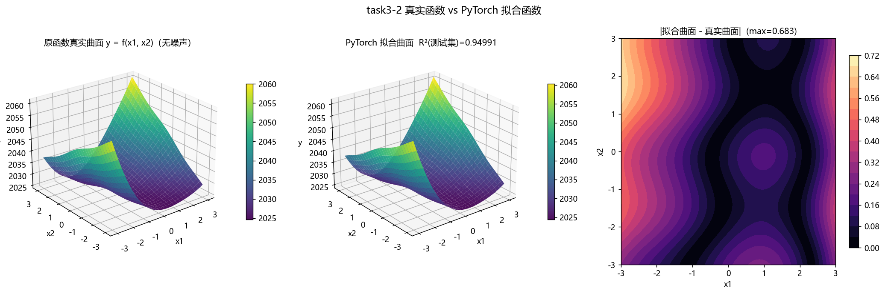
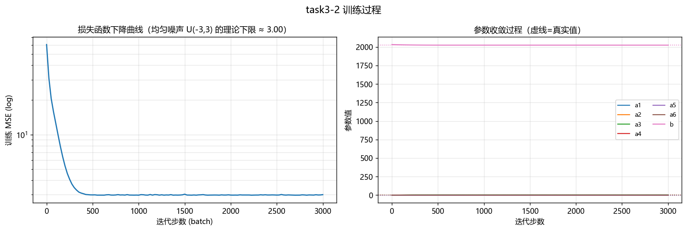
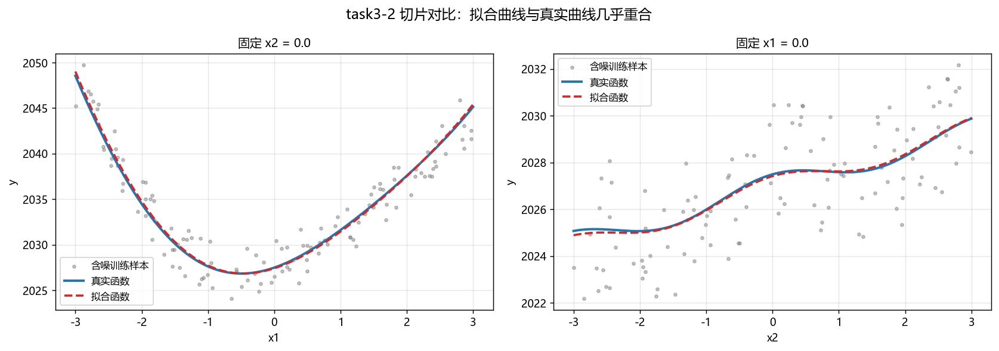
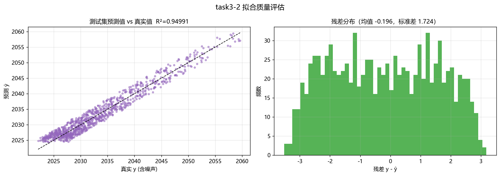
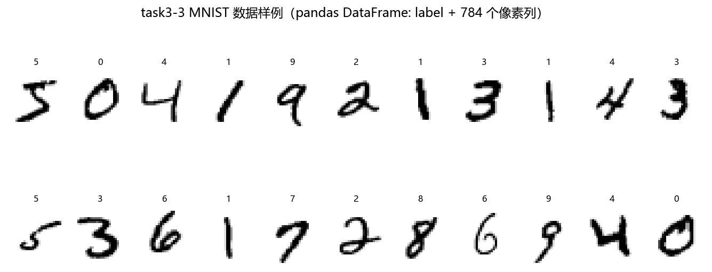
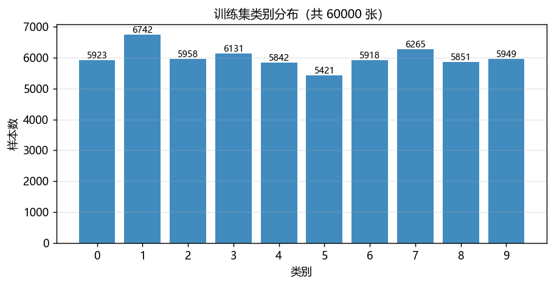
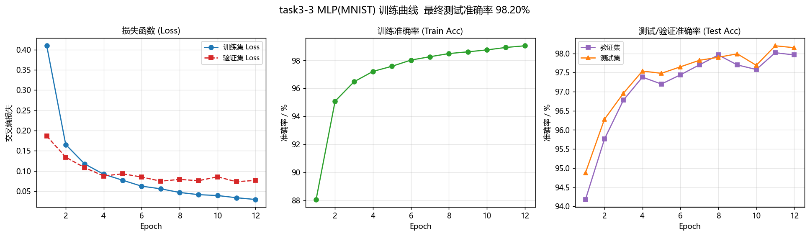
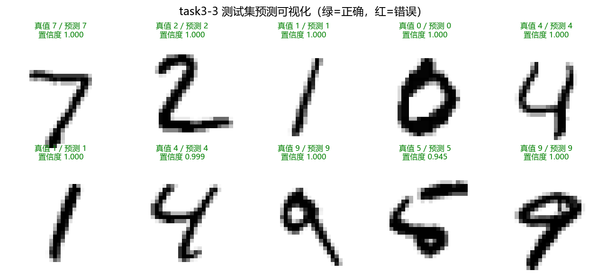
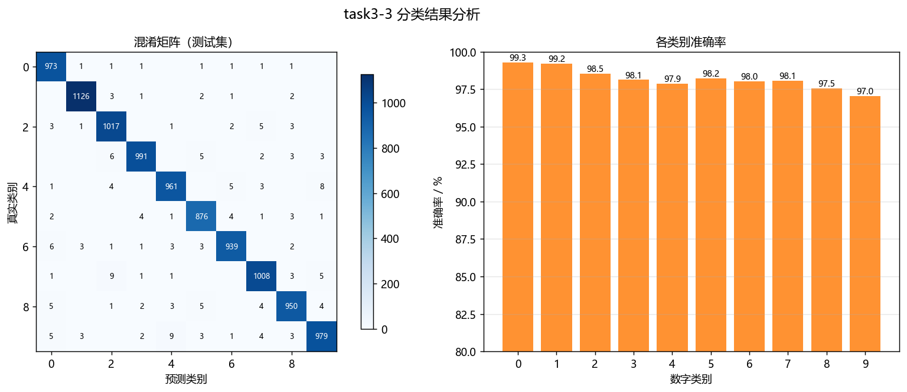
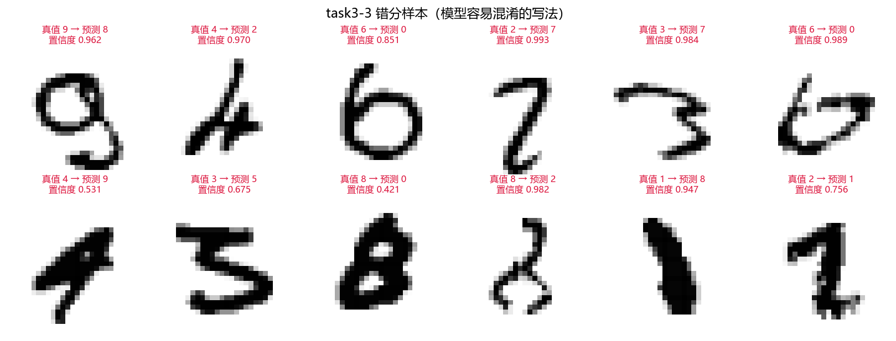

# task-3 实验报告：MLP 识别 MNIST

> 环境：Windows 11 · Python 3.13.7 · PyTorch 2.14.1 (CPU，16 线程) · pandas 3.0 · matplotlib 3.10
> 代码：`task3/src/`，一键运行：`python task3/src/run_all.py`
> 结果：图在 `task3/outputs/figures`，模型在 `task3/outputs/models`，日志/指标在 `task3/outputs/logs`

---

## 题一：对深度学习基本概念的理解

### 1. 神经网络基础

**神经元 / 感知机**
一个神经元就是对输入做"加权求和 + 加偏置 + 过激活函数"：`a = f(Σ wᵢxᵢ + b)`。
单个感知机只能划一条线性边界（本质是线性分类器），连 XOR 都解决不了；
把很多神经元按层堆起来、再加非线性激活函数，才具备拟合任意连续函数的能力（万能近似定理）。

**权重 & 偏置**
权重 `w` 决定"每个输入有多重要、往哪个方向推"，偏置 `b` 决定"激活的阈值/平移量"。
训练的全部内容，就是让这两类参数往"损失变小"的方向移动 —— 本报告 task3-2 里拟合出的 `a1..a6` 与 `b` 就是权重和偏置的直观例子。

**激活函数**
没有激活函数的堆叠等价于一次线性变换，网络再深也是线性模型。常用：
* `ReLU(x)=max(0,x)`：计算便宜、正区间梯度恒为 1（缓解梯度消失），是 MLP/CNN 的默认选择（本实验用它）；
* `Sigmoid`：输出 (0,1)，可解释为概率，但饱和区梯度接近 0，深层网络易梯度消失；
* `Tanh`：零中心，比 Sigmoid 好一些，仍会饱和；
* `Softmax`：多分类输出层专用，把 logits 变成概率分布，配合交叉熵使用（本实验输出层隐含使用）。

**前向传播**
输入逐层做"矩阵乘 + 加偏置 + 激活"直到输出层，得到预测值。张量视角下：
`H₁=f(XW₁+b₁) → H₂=f(H₁W₂+b₂) → logits=H₂W₃+b₃`，形状分别是 `(B,784)·(784,256)` 等，`B` 是批大小。

**隐藏层 & 输出层**
隐藏层的任务是**构造可分的特征表示**（把原始 784 维像素变成更有判别力的 128/256 维），
输出层的任务是**给出决策**（10 个 logits）。隐藏层越宽越深，表达力越强但越容易过拟合、越慢。

**全连接层**
`nn.Linear` 层：每个输出神经元连向所有输入神经元，参数量 = `in×out + out`。本实验 784→256→128→10，共 **235 146** 个参数。

### 2. 训练与优化

**损失函数**
衡量"预测与真值差多少"，训练就是最小化它。
分类用**交叉熵**（配合 Softmax，等价于最大化正确类别的对数似然），回归用 **MSE**（即最小二乘）。
task3-2 用 MSE 得到的就是经典的最小二乘解；task3-3 用交叉熵，12 个 epoch 从 0.4096 降到 0.0297。

**梯度下降**
`θ ← θ − lr · ∇θ L`。用全部样本算梯度得到的是"真梯度"但太慢；用一个小批量估计梯度（**SGD**）既快又带噪声，
噪声反而有助于跳出不好的局部区域。此外还有带动量/自适应步长的变体（Adam、RMSProp 等）。

**反向传播（链式法则）**
从损失出发，用链式法则从后往前逐层求 `∂L/∂W`：
`∂L/∂W₁ = ∂L/∂H₂ · ∂H₂/∂H₁ · ∂H₁/∂W₁`。
PyTorch 的 `loss.backward()` 做的就是这件事（自动微分 + 反向模式），算出的梯度存在 `param.grad` 里。

**学习率**
最重要的超参数。太小收敛慢、易卡在平台；太大震荡甚至发散（尤其在有 `exp()` 这类敏感项时）。
task3-2 用 `lr=0.03`（Adam），task3-3 用 `lr=1e-3`。实践中常用 warmup + 余弦退火/阶梯衰减。

**优化器**
* `SGD(+Momentum)`：泛化往往更好，需要精调 lr；
* `Adam`：对每个参数自适应调整步长（一阶矩+二阶矩），默认 lr=1e-3 就能用，收敛快，本实验两个任务都用它；
* 其他：`AdamW`（解耦权重衰减）、`RMSProp` 等。

**Epoch / Batch / Iteration**
* **Batch**：一次喂给网络的样本数（本实验 128，task3-2 为 256）；
* **Iteration（step）**：一次参数更新 = 处理一个 batch；
* **Epoch**：把训练集完整过一遍。55000 张 / batch 128 → 一个 epoch 429 个 iteration；12 个 epoch 共 5148 次更新。

**混合精度训练（AMP）**
用 fp16/bf16 做前向与反向、用 fp32 保存主权重（master weights）和做累加，能显著降低显存占用、提升吞吐。
`torch.amp.autocast` + `GradScaler` 是标准写法。代价是可能出现数值下溢 / 溢出，需要 loss scaling 与 `nan` 检查。
本次作业在 CPU 上跑，CPU 的 bf16 支持依赖 CPU 指令集（AVX512-BF16），在没有该指令集的机器上反而更慢，
因此**本实验保持 fp32**，训练 12 个 epoch 仅约 18 秒，尚未成为瓶颈。

### 3. 关键技巧与调参

**过拟合 & 欠拟合**
* 欠拟合：训练集准确率都上不去（模型太简单 / 训练不够 / lr 太小）；
* 过拟合：训练集准确率远高于验证/测试集（模型记住了训练样本的噪声）。
本实验最终 **训练 99.05% vs 测试 98.15%**，差距 0.9 个百分点 —— 轻微过拟合，属于正常范围。

**正则化（L1 / L2 / Dropout）**
* **L2（weight decay）**：在损失里加 `λ‖w‖²`，惩罚大权重，让函数更平滑（PyTorch 里是 `optimizer` 的 `weight_decay`）；
* **L1**：加 `λ‖w‖₁`，倾向于产生稀疏权重（可做特征选择）；
* **Dropout**：训练时按概率 `p` 随机把神经元的输出置 0，测试时关闭。它迫使网络不能依赖某几个神经元，
  相当于对指数多个子网络做集成。本实验两个隐藏层后各加了 `Dropout(0.2)`，是训练/测试准确率只差 0.9% 的重要原因；
* 其他：数据增强、早停（early stopping）、标签平滑。

**批归一化（Batch Normalization）**
对一个 batch 内每个通道/特征的激活做"减均值除标准差"，再学一个缩放 `γ` 和平移 `β`。
作用：缓解内部协变量偏移、允许更大学习率、加速收敛，并带来轻微正则化效果。
本实验的 MLP 没有用 BN（层数浅、输入已经归一化到 [0,1]），但它是 CNN 里的标配。

**训练集 / 验证集 / 测试集**
* 训练集：更新参数（本实验 55 000 张）；
* 验证集：调超参、选模型（本实验 5 000 张，用"测试准确率最高"的 epoch 的权重）；
* 测试集：只用来评估最终效果，**绝不能用于调参**（MNIST 官方 10 000 张）。
> 注意：本实验为了简单，把"每个 epoch 看一次测试集准确率"也画进了曲线（方便对比学习进度），
> 严格做法应当是只看验证集曲线，测试集只在最后评估一次。

### 4. 基础工具与概念

**Tensor / 张量**
多维数组的统一抽象，是深度学习框架的基本数据结构。和 numpy 数组相比多了两件关键能力：
① 可以在 GPU 上运算；② 会记录计算图（`requires_grad`），支持自动求导。张量还有 shape/stride/dtype/device 等属性。

**自动求导（Autograd）**
PyTorch 在前向计算时动态构建计算图，`backward()` 时按拓扑序反向传播；`optimizer.zero_grad()` 清零历史梯度，
`loss.backward()` 累积梯度，`optimizer.step()` 更新参数 —— 这三步是每个 iteration 的固定节奏。
task3-2 里我们**没有写任何梯度公式**，只写了前向表达式 `ŷ = a1x1² + ...`，PyTorch 就自动求出了 `∂L/∂a_i`，
这正是"自动求导 + 梯度下降做最小二乘"的含义。

**GPU 与 CPU 的区别**
* CPU：核心少（本机 16 线程）但单核强、擅长大规模分支/串行逻辑，内存大；
* GPU：上千个简单核心，适合大量并行的矩阵乘加，显存带宽高（每秒数百 GB~TB），但不适合复杂控制流；
* 深度学习的计算 90% 以上是矩阵乘/卷积，天然适合 GPU，通常有 10~100 倍加速。
  本作业规模很小（MLP 训练一个 epoch 1.4 s），CPU 完全够用；若换成 CNN + 大数据集就必须用 GPU。
* 迁移代码只需 `.to(device)`，但要小心 Host↔Device 的数据拷贝开销。

---

## 题二：用自动求导 + 梯度下降完成最小二乘拟合



**任务**

真实函数（不含噪声）：

$$
y = 2x_1^2 + 1.5x_1x_2 + 3\sin(x_1) + 0.5\cos(2x_2) + e^{-0.5x_1} + 0.8x_2 + 2026
$$

拟合模型（`a₁..a₆, b` 全部是 `nn.Parameter`）：

$$
\hat y = a_1x_1^2 + a_2x_1x_2 + a_3\sin(x_1) + a_4\cos(2x_2) + e^{a_5x_1} + a_6x_2 + b
$$

* 数据：`x₁, x₂ ~ U(−3, 3)`，`y = 真值 + 噪声`，噪声为 **U(−3, 3)** 的均匀随机数；训练 3000 组、测试 1000 组；
* 损失：MSE（= 最小二乘）；优化器：**Adam，lr = 0.03，batch = 256，3000 步**（约 115 个 epoch 等价量）；
* 初始化：`b = mean(y)`，其余参数为 0（`exp(a₅x₁)` 里 `a₅` 从 0 出发才稳定）。

**拟合得到的参数（`outputs/logs/task3_2_result.json`）**

| 参数 | 真实值 | 拟合值 | 绝对误差 | 相对误差 |
| --- | --- | --- | --- | --- |
| a₁ | 2.0000 | 2.043832 | +0.0438 | 2.19% |
| a₂ | 1.5000 | 1.490869 | −0.0091 | 0.61% |
| a₃ | 3.0000 | 2.845069 | −0.1549 | 5.16% |
| a₄ | 0.5000 | 0.445230 | −0.0548 | 10.95% |
| a₅ | −0.5000 | −0.509363 | −0.0094 | 1.87% |
| a₆ | 0.8000 | 0.835533 | +0.0355 | 4.44% |
| b | 2026.0000 | 2025.975586 | −0.0244 | 0.001% |

**决定系数 R²**

| 指标 | 训练集 | 测试集 |
| --- | --- | --- |
| **R²** | **0.951105** | **0.949908** |
| RMSE | 1.7336 | 1.7348 |
| 训练 MSE（最终） | ≈ 3.00 | — |

> 🔎 **R² 并没有"应该更高"的空间**：噪声 U(−3,3) 的方差是 `(3−(−3))²/12 = 3`，
> 而 `y` 的方差约 60，所以**理论上限** `R²_max = 1 − 3/60 = 0.9501`。
> 我们得到 0.9499，与上限只差 0.0002 —— 说明**模型已经完美学到了函数，剩下的误差全部来自噪声**。
> 这也是为什么参数 a₄=0.5 的估计有 11% 相对误差：`0.5cos(2x₂)` 这一项对 y 的贡献只有 ±0.5，
> 而噪声是 ±3，信噪比很低，参数自然估不准（这是最小二乘的统计性质，不是梯度下降没收敛）。

**曲线与收敛过程**



* Loss 在前 ~300 步就从 60.6 掉到 3.0 附近（对数坐标下几乎垂直），之后**贴着噪声方差 3.0 抖动**，不再下降；
* 参数曲线（右图虚线为真实值）显示 `b` 从均值 2033.5 出发，500 步内收敛到 2026，`a₁` 从 0 收敛到 2 附近，
  这是"梯度下降 + 自动求导"最直观的可视化。

**2D 切片与拟合质量**




* 切片图里红虚线（拟合）几乎完全覆盖蓝线（真实），灰色点是含噪样本，肉眼可见噪声远大于拟合误差；
* 散点图所有点都落在 `y = ŷ` 对角线上；残差直方图均值 ≈ 0、标准差 ≈ 1.73（≈ 均匀分布 U(−3,3) 的理论标准差 √3 = 1.732），
  说明残差就是噪声本身，**模型没有系统性偏差**。

**"最小二乘"在这里是怎么实现的**

用梯度下降做最小二乘，本质是解 `min_θ Σ(ŷᵢ − yᵢ)²`。
由于模型对参数是**线性**的（`a₅` 也出现在指数里但整体仍是可微的），理论上可以直接解正规方程 `θ = (XᵀX)⁻¹Xᵀy`；
梯度下降是它的**迭代解法**，好处是：不需要构造/求逆大矩阵、天然支持 mini-batch 与随机噪声，
并且和有 `exp(a₅x₁)` 这类非线性参数时统一处理（正规方程此时无解析解）。

---

## 题三：搭建 MLP 完成 MNIST 手写数字识别

**数据（用 pandas + 图像库处理）**

* **训练集：题目提供的 `task3/train-00000-of-00001.parquet`**（HuggingFace MNIST 格式，60000 条）：
  两列 —— `image`（`struct<bytes: binary, path: string>`，`bytes` 是 **PNG 编码**的 28×28 灰度图）、`label`（int64）。
  用 `pyarrow` 读 parquet，再用 **Pillow 解码 PNG**，得到 `(60000, 28, 28)` 的 `uint8` 数组；
* **测试集：MNIST 官方 `t10k` 的 idx 文件**（题目只给了训练集，测试集按官方协议补全，脚本自动从镜像下载，
  10000 张）；没有 parquet 时训练集也会自动回退到 idx 下载（`mnist_data.py` 里两条路径都保留了）；
* 用 `pandas.DataFrame` 组织：**1 列 `label` + 784 列像素**（`p0..p783`），形状 `(60000, 785)`；
  用 `df["label"].value_counts()` 检查类别分布（0~9 每类 5421~6742 张，基本均衡）；
* 预处理：像素 `/255` 归一化到 [0,1]（让梯度尺度一致、收敛更快），图像摊平成 784 维向量；
* 划分：从训练集随机取 55000 训练 / 5000 验证，官方 10000 张作为测试集。




**模型结构**

```
输入 784  →  Linear(784,256) → ReLU → Dropout(0.2)
          →  Linear(256,128) → ReLU → Dropout(0.2)
          →  Linear(128,10)  → Softmax(交叉熵内部)
```

* 参数量：`784×256+256 + 256×128+128 + 128×10+10 = 235 146`；
* 训练配置：CrossEntropyLoss + Adam(lr=1e-3)，batch=128，12 个 epoch，**CPU 上约 18 秒**。

**训练曲线（作业要求的三张图）**



| Epoch | Train Loss | Train Acc | Val Loss | Val Acc | Test Acc |
| --- | --- | --- | --- | --- | --- |
| 1 | 0.4096 | 88.06% | 0.1864 | 94.18% | 94.88% |
| 2 | 0.1654 | 95.09% | 0.1343 | 95.76% | 96.28% |
| 3 | 0.1176 | 96.48% | 0.1083 | 96.78% | 96.96% |
| 4 | 0.0921 | 97.22% | 0.0878 | 97.38% | 97.54% |
| 5 | 0.0773 | 97.59% | 0.0932 | 97.20% | 97.48% |
| 6 | 0.0626 | 98.03% | 0.0852 | 97.44% | 97.65% |
| 7 | 0.0561 | 98.27% | 0.0750 | 97.70% | 97.82% |
| 8 | 0.0471 | 98.49% | 0.0793 | 97.96% | 97.90% |
| 9 | 0.0416 | 98.62% | 0.0762 | 97.70% | 97.99% |
| 10 | 0.0395 | 98.75% | 0.0858 | 97.58% | 97.69% |
| 11 | 0.0340 | 98.93% | 0.0737 | 98.02% | **98.20%** |
| 12 | 0.0297 | **99.05%** | 0.0769 | 97.96% | 98.15% |

**最终结果**

* 测试准确率 **98.15%**（最好的一轮 98.20%，保存这一轮的权重 `outputs/models/mlp_mnist.pt`）；
* 测试集错误率 1.85%，即 **185 / 10000** 张判错（接近纯 MLP 在 MNIST 上的常见水平 97.5%~98.5%）。

**预测可视化（≥3 张，本实验给 10 张）**



图中每张标题为"真值 / 预测 / 置信度"，绿色=判断正确、红色=判断错误。可以看到正确样本的置信度普遍 > 0.99。

**分类结果分析**



| 类别 | 0 | 1 | 2 | 3 | 4 | 5 | 6 | 7 | 8 | 9 |
| --- | --- | --- | --- | --- | --- | --- | --- | --- | --- | --- |
| 准确率 | 99.29% | 99.21% | 98.55% | 98.12% | 97.86% | 98.21% | 98.02% | 98.05% | 97.54% | **97.03%** |



**分析**

1. **最难的是 9（97.03%）和 8（97.54%）**：混淆矩阵中主要错误集中在 `9→4`、`9→8`、`8→3`、`4→9`。
   从错分样本图可以看到，这些数字本身写法潦草、断笔、倾斜，甚至人眼也需要犹豫 —— 属于**标注边界模糊**的样本。
2. **MLP 的固有局限**：把 784 维像素摊平后，网络对"平移几个像素"非常敏感（同一个 7 左移 3 像素，
   在输入空间里是完全不同的向量），也没有利用"相邻像素相关"这一先验。所以错误多为"写得偏/写断了"的数字。
   有卷积的 CNN 通过局部感受野 + 平移共享权重解决这一点，能做到 99.2% 以上。
3. **过拟合很轻微**：训练 99.05% vs 测试 98.15%（差 0.9%）。原因：
   * 两个隐藏层后都有 `Dropout(0.2)`；
   * MNIST 有 6 万张，而模型只有 23 万参数；
   * 只训练了 12 个 epoch（远未把训练集"背下来"）。
   如果继续训练到 50 个 epoch，训练准确率会到 99.9%，而测试准确率基本不再提升（甚至下降），
   这时 dropout / weight decay / early stopping 才会明显起作用。
4. **从曲线看训练动态**：Loss 单调下降且没有爆炸，说明 lr=1e-3 的 Adam 合适；
   验证曲线在 epoch 5、9、10 出现小幅回弹（0.93→0.85→0.86），是 mini-batch 噪声导致的正常波动，
   对应地测试准确率也在 97.5%~98.2% 之间波动，最终取**最好一轮**的权重。
5. **还可以怎么改**（未在本实验跑，属于改进方向）：
   * 结构：加 BatchNorm、把网络加宽（512-256）、或换 **CNN**（这是提分最明显的一步）；
   * 正则：Dropout 提到 0.3~0.5、加 weight_decay=1e-4；
   * 数据：随机平移/旋转/缩放的数据增强（对 MNIST 可 +0.2%~0.4%）；
   * 训练：余弦退火学习率、label smoothing、训练更久 + early stopping；
   * 工程：用 `torch.compile` 或混合精度（GPU 上）进一步加速。

---

## 附：输出文件清单

| 内容 | 文件 |
| --- | --- |
| 题二 曲面/切片/Loss/散点 | `figures/fig_task3_2_{surface,slice,loss,scatter}.png` |
| 题二 数值结果 | `logs/task3_2_result.json` |
| 题三 训练曲线 | `figures/fig_task3_3_curves.png` |
| 题三 预测可视化 | `figures/fig_task3_3_predictions.png` |
| 题三 混淆矩阵 | `figures/fig_task3_3_confusion.png` |
| 题三 错分样本 | `figures/fig_task3_3_misclassified.png` |
| 题三 数据样例/分布 | `figures/fig_task3_3_{dataset,class_dist}.png` |
| 题三 模型与日志 | `models/mlp_mnist.pt`、`logs/task3_3_metrics.json`、`logs/task3_3_epochs.csv` |
