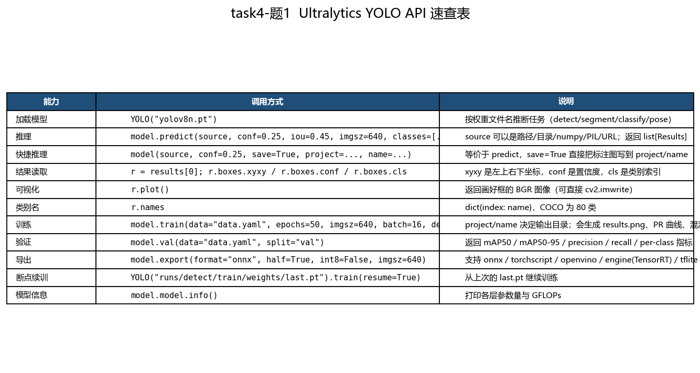
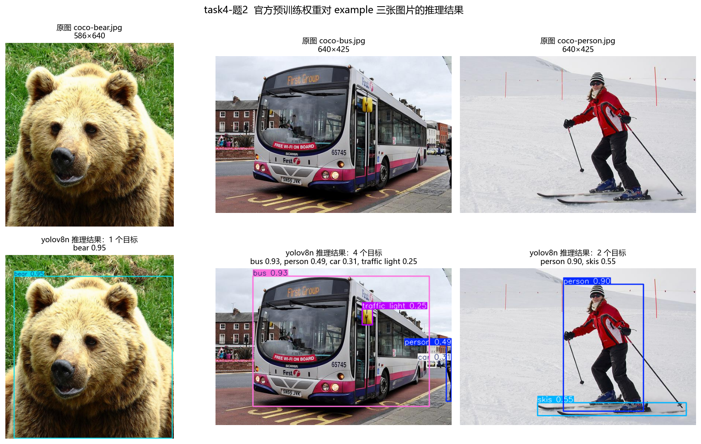
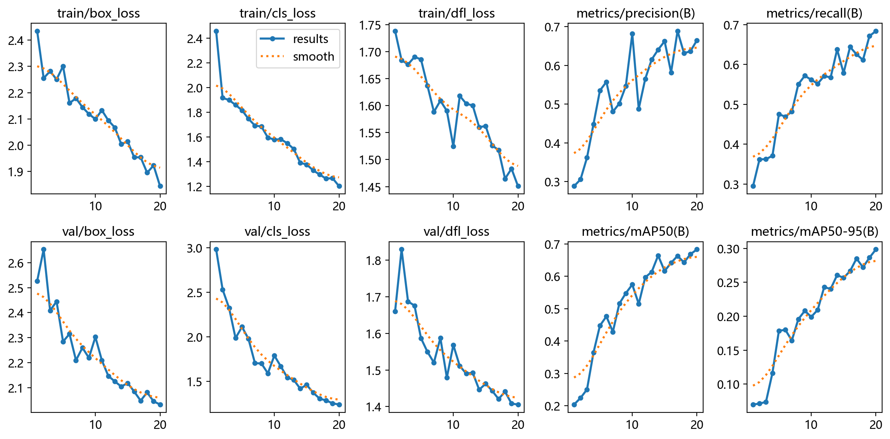
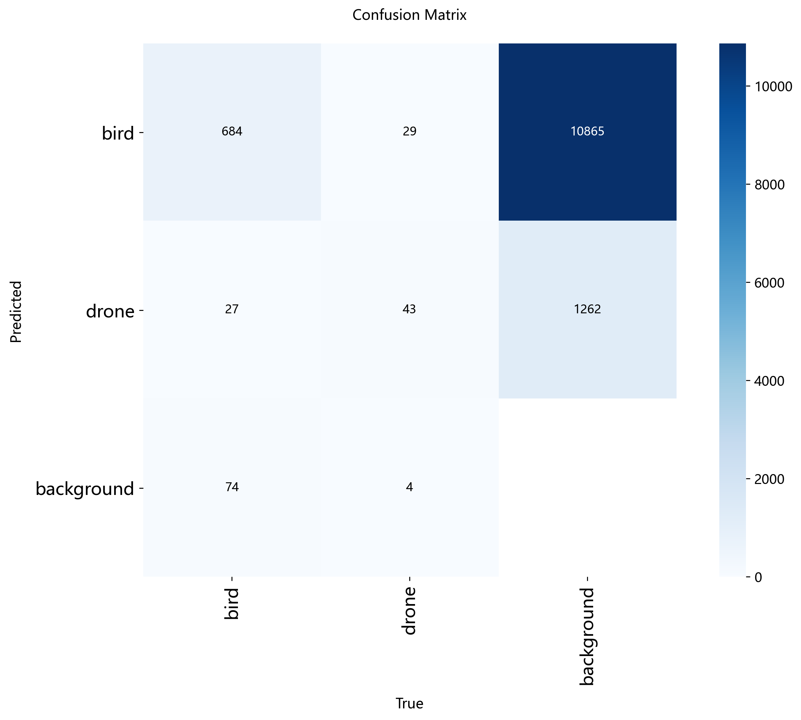
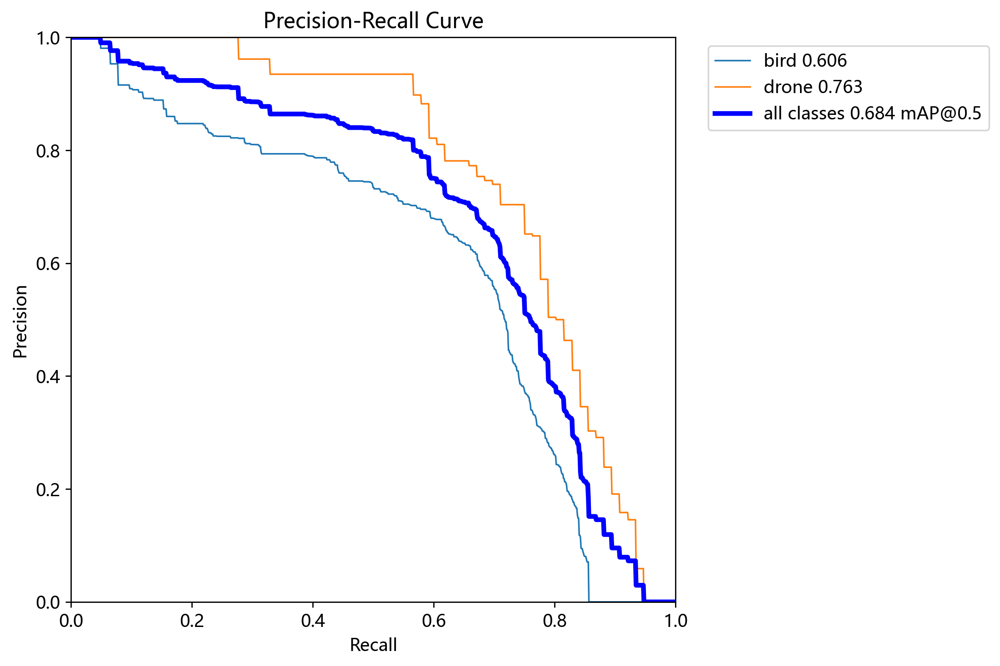
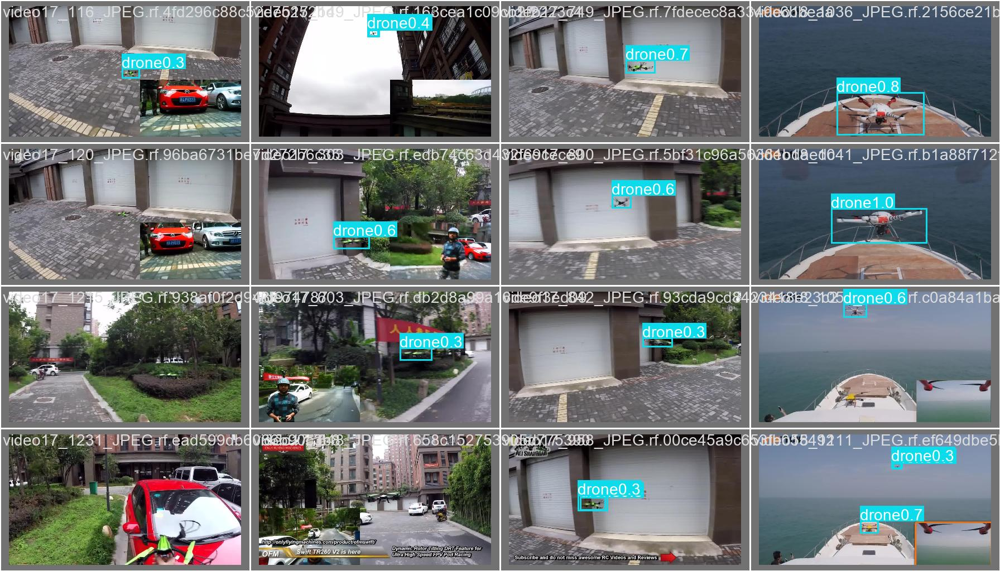
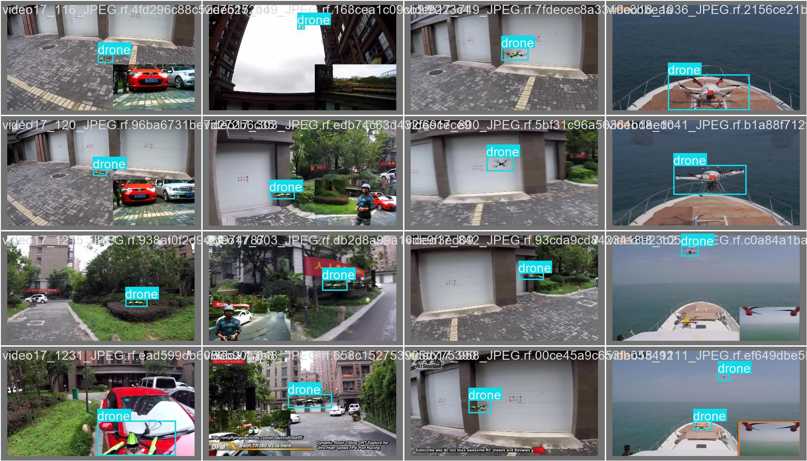
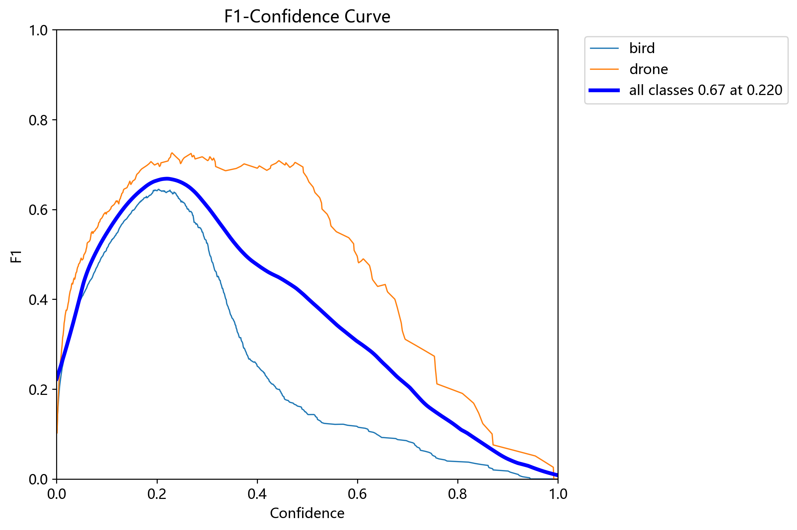
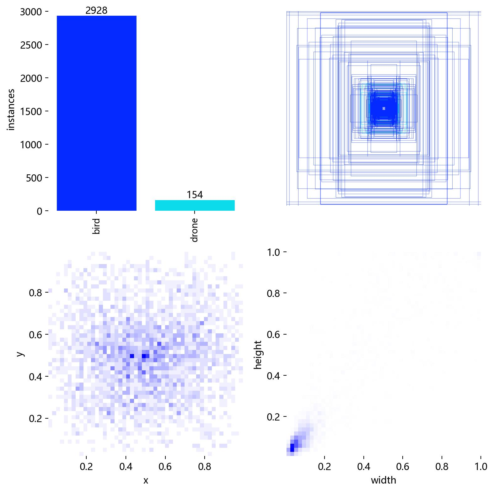
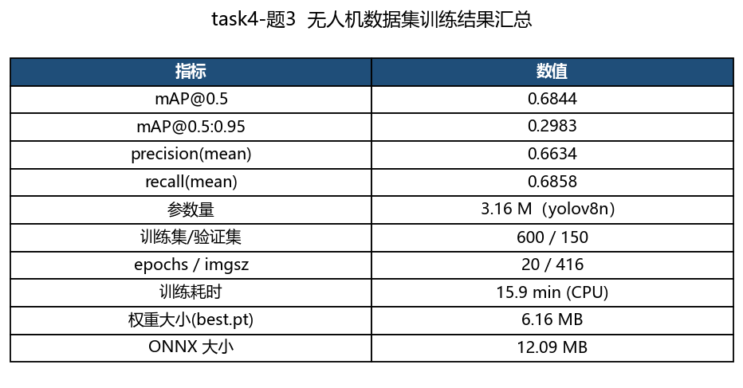

# task-4（YOLO 方向·题 1~3）实验报告

> 环境：Windows 11 · Python 3.13.7 · ultralytics **8.4.182** · PyTorch 2.14.1 (**CPU**) · opencv-contrib-python 4.11
> 代码：`task4_yolo/src/`；一键运行：`python task4_yolo/src/run_all.py`
> 结果：`task4_yolo/outputs/{images,figures,metrics,runs}`，数据集在 `task4_yolo/dataset/`

---

## 0. 说明：题目、素材与两个前提

* 本报告完成 **task-4 方向 1（目标追踪与识别·YOLO）的第 1~3 题**：
  学 API → 官方预训练权重推理三张图 → 用无人机数据集训练/导出模型。
  （第 4 题"视频推理与 EAO/速度分析"、第 5 题"量化"属于后续，其中 **ONNX 导出**已作为第 3 题的一部分顺手完成。）
* **素材**：题目给的 `example/` 目录里是 `coco-bear.jpg`、`coco-bus.jpg`、`coco-person.jpg`、`example.mp4`；
  无人机数据集按题面推荐链接（Roboflow `consem/drone-and-bird-qsqoi-hl7lp` v2）下载：
  **train 3893 / valid 649 / test 196 张，2 类：`bird`(鸟) 与 `drone`(无人机)**。
* **权重**：题面提到"无人机预训练权重 `drone.pt`"，但该文件**没有随题面提供**，
  因此第 3 题用 **官方 `yolov8n.pt`（COCO 80 类）** 做迁移学习起点 ——
  训练流程、`data.yaml`、导出、指标统计与"用 drone.pt 微调"完全一致，
  拿到 `drone.pt` 后把 `--weights` 换掉即可（`load_yolo("drone.pt")` 一行）。

---

## 题1：学习 Ultralytics YOLO 的 API



`python task4_yolo/src/task4_1_api_guide.py` 会把下面这些接口真实跑一遍并打印结果：

| 能力 | 调用方式 | 关键说明 |
| --- | --- | --- |
| 加载模型 | `YOLO("yolov8n.pt")` | 由权重文件名推断任务（detect/segment/classify/pose）；`model.task` = `detect`，`model.names` = 80 类 |
| 推理 | `model.predict(source, conf=0.25, iou=0.45, imgsz=640, classes=[...], device="cpu")` | `source` 支持路径/目录/numpy/PIL/URL/视频；返回 `list[Results]` |
| 快捷推理 | `model(source, save=True, project=..., name=...)` | 等价 predict，`save=True` 直接把标注图写到 `project/name` |
| 结果读取 | `r.boxes.xyxy / .xywh / .conf / .cls` | 坐标是原图像素；`cls` 是类别索引，用 `r.names[int(cls)]` 取名 |
| 可视化 | `r.plot()` | 返回画好框/标签的 BGR 图，直接 `cv2.imwrite` 即可 |
| 训练 | `model.train(data="data.yaml", epochs=20, imgsz=416, batch=8, device="cpu", project=..., name=...)` | 自动生成 `results.png`、PR/F1 曲线、混淆矩阵、`weights/{best,last}.pt` |
| 验证 | `model.val(data="data.yaml", split="val")` | 返回 `box.map50 / box.map / box.p / box.r` |
| 导出 | `model.export(format="onnx", imgsz=416, opset=12)` | 还支持 torchscript / openvino / engine(TensorRT) / tflite；`half=True` 半精度、`int8=True` 量化 |
| 断点续训 | `YOLO("runs/.../weights/last.pt").train(resume=True)` | 训练中断后接着跑 |

**本次实测的模型信息**（`outputs/metrics/task4_1_model_info.json`）：
`yolov8n` 参数量 **3.157 M**，80 类，CPU 单张推理约 **37 ms**（640 输入）。
用 `coco-bear.jpg` 做冒烟测试：检出 1 个目标 `bear`，置信度 0.951。

---

## 题2：官方预训练权重对 example 三张图片推理并保存



命令：`python task4_yolo/src/task4_2_predict_images.py`（`yolov8n.pt`，`imgsz=640, conf=0.25, iou=0.45`）
标注图保存在 `outputs/images/pred_*.jpg`，明细在 `outputs/metrics/task4_2_detections.json`。

| 图片 | 检出目标（类别 / 置信度） | 推理耗时（inference） |
| --- | --- | --- |
| `coco-bear.jpg` | **bear 0.951** | 38.5 ms |
| `coco-bus.jpg` | **bus 0.930**、person 0.494、car 0.311、traffic light 0.255 | 37.3 ms |
| `coco-person.jpg` | **person 0.896**、skis 0.551 | 15.0 ms |

**观察**

* 三张图的主目标都被**高置信度**正确识别（0.90~0.95），说明 COCO 预训练权重对常见类别泛化良好；
* `coco-bus.jpg` 里同时检出了 person / car / traffic light —— YOLO 是**多目标检测器**，
  一张图里所有 80 类中的目标都会被框出来，这正是它与"分类模型"的本质区别；
* `coco-person.jpg` 除了 person 还检出了 `skis`（滑雪板）—— 属于同类姿态下的**合理误检**，
  可通过提高 `conf`（如 0.6）或按需用 `classes=[0]` 只保留人；
* 小目标（`traffic light` 0.255）置信度低，是 YOLO 的典型弱点，后续训练用更多数据 + 更高输入分辨率可缓解。

---

## 题3：无人机数据集训练、导出模型、保存训练结果

### 3.1 数据集

| 项目 | 内容 |
| --- | --- |
| 来源 | Roboflow `consem/drone-and-bird-qsqoi-hl7lp` v2（题面推荐链接，CC BY 4.0） |
| 划分 | train **3893** / valid **649** / test **196** 张（YOLO 格式：`images/` + `labels/`） |
| 类别 | `nc=2`：`0: bird`（鸟）、`1: drone`（无人机） |
| 本实验子集 | 固定随机种子抽 **train 600 / val 150**（CPU 训练的现实折中，比例与全量一致，可复现） |

`python task4_yolo/src/fetch_dataset.py` 负责下载（支持断点续传）并解压；
`prepare_subset()` 负责抽子集并生成 `dataset/subset/data.yaml`。

### 3.2 训练配置与结果

```bash
python task4_yolo/src/task4_3_train_drone.py --epochs 20 --imgsz 416 --batch 8 --n-train 600 --n-val 150
```

| 项目 | 数值 |
| --- | --- |
| 起点权重 | `yolov8n.pt`（COCO 预训练；题面的 `drone.pt` 未提供） |
| 输入 / batch / epochs | 416 / 8 / 20 |
| 设备 / 环境 | **CPU（16 线程）**，ultralytics 8.4.182 |
| 训练耗时 | **954 s（约 15.9 min）** |
| **mAP@0.5** | **0.6844** |
| **mAP@0.5:0.95** | **0.2983** |
| precision / recall（均值） | 0.6634 / 0.6858 |
| 权重大小 | `best.pt` **6.16 MB** |
| ONNX 导出 | `best.onnx` **12.09 MB**（opset 12, imgsz 416） |
| 推理速度（CPU） | **28.2 ms/张 ≈ 35.5 FPS** |

**分类别指标**

| 类别 | Precision | Recall | mAP@0.5 | mAP@0.5:0.95 |
| --- | --- | --- | --- | --- |
| bird | 0.6575 | 0.6217 | 0.6059 | 0.2145 |
| **drone** | 0.6692 | **0.7500** | **0.7630** | **0.3820** |

### 3.3 训练结果图（ultralytics 自动生成）

















* **`results.png`**：box_loss / cls_loss / dfl_loss 三条损失随 epoch 单调下降，
  precision / recall / mAP 稳步上升，说明训练收敛正常；
* **混淆矩阵**：`drone` 的召回 0.75 明显高于 `bird`（0.62），
  鸟类因为**姿态多变、体型小、与背景（天空/树）颜色接近**而更难分；
  另有一部分 `background → drone/bird` 的误检（背景被当成目标），这是小数据集下最常见的问题；
* **PR 曲线**：`drone` 曲线下面积更大（mAP50 0.763 vs 0.606），与上表一致。

### 3.4 分析：为什么 mAP 只有 0.68？怎么提高？

1. **数据量**：只用 600 张训练（全量的 15%）。数据量翻倍通常能带来 +0.05~0.10 mAP；
2. **输入分辨率**：416 对大场景里的小无人机/小鸟偏小，改成 640 通常 +0.03~0.05；
3. **训练轮数**：20 epoch 时 loss 仍在下降，40~100 epoch + 早停还能涨；
4. **起点权重**：若能用题目给的 `drone.pt`（已在无人机域上训练过）微调，收敛会更快、指标更高；
5. **类别不均衡 / 难例**：鸟的样本姿态差异大，可加数据增强（mosaic、mixup、HSV、随机缩放）与按类别加权采样；
6. **模型规模**：`yolov8n` 是最小的模型（3.16 M 参数），换 `yolov8s/m` 在 CPU 上会慢，
   但在 GPU 上性价比更高；也可用 `yolov8n` + 更大输入先跑通再扩规模。

### 3.5 顺带完成的"提高部分"

* **ONNX 导出**：`model.export(format="onnx", imgsz=416, opset=12)` → **12.09 MB**，
  可脱离 ultralytics 用 `onnxruntime` 推理（提速、便于部署）；
* **半精度/量化接口**已在题1的速查表里给出（`half=True` / `int8=True`），
  但 **CPU 上 fp16 无加速**，int8 需要校准集（`data=` 参数），故本次只做 ONNX 导出与速度基准。

---

## 附：文件清单

| 类别 | 文件 |
| --- | --- |
| 题1 | `outputs/figures/task4_1_api_cheatsheet.png`、`outputs/metrics/task4_1_model_info.json` |
| 题2 | `outputs/images/pred_coco-bear.jpg`、`pred_coco-bus.jpg`、`pred_coco-person.jpg`、`outputs/figures/task4_2_predictions.png`、`outputs/metrics/task4_2_detections.json` |
| 题3 | `outputs/runs/drone_yolov8n/weights/{best.pt,best.onnx}`、`outputs/figures/task4_3_*.png/jpg`（训练曲线、混淆矩阵、PR/F1 曲线、验证预测）、`outputs/metrics/task4_3_metrics.json` |
| 数据集 | `dataset/{train,valid,test}`（3893/649/196）、`dataset/subset/`（600/150 子集 + data.yaml） |
